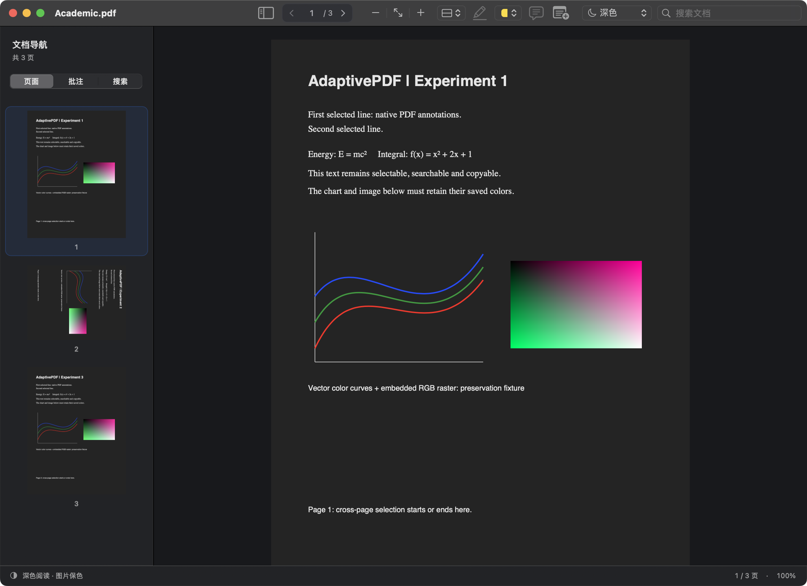
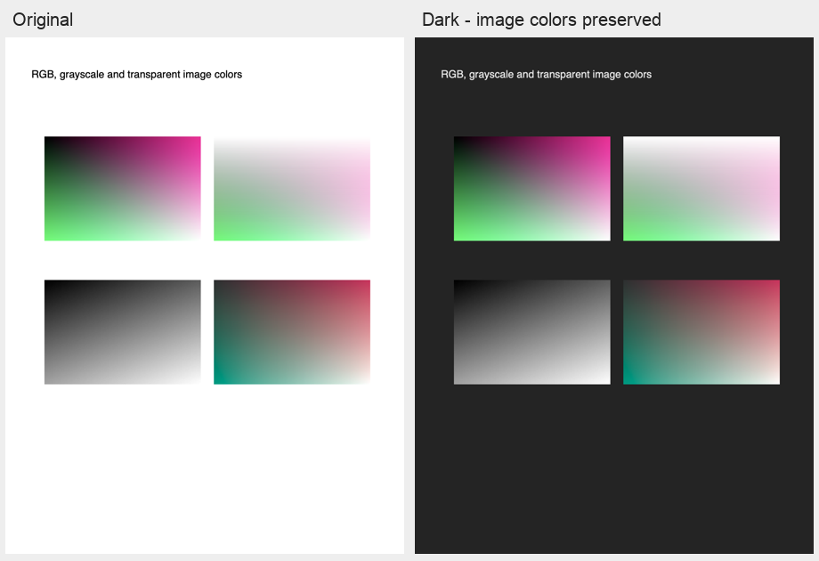

# AdaptivePDF

面向论文阅读的原生 macOS PDF 阅读器。页面可以变成深灰底、浅色正文，嵌入图片保持原色；支持文字选择、全文搜索、高亮、评论和便签。

使用 Swift、AppKit、PDFKit、Core Graphics 与 qpdf 构建，文件在本机处理，无需注册账号。

**当前版本：1.0.0 预览版（build 10）。** 安装包采用本地 ad-hoc 签名，尚未完成 Developer ID 签名和 Apple 公证。

## 下载

- [下载 macOS 安装包（DMG）](https://github.com/MrszhuL/AdaptivePDF/releases/download/v1.0.0-build10/AdaptivePDF.dmg)
- [下载应用压缩包（ZIP）](https://github.com/MrszhuL/AdaptivePDF/releases/download/v1.0.0-build10/AdaptivePDF-macOS.zip)
- [版本说明、源码与 SHA256 校验文件](https://github.com/MrszhuL/AdaptivePDF/releases/tag/v1.0.0-build10)

两个安装包包含相同的 Universal 应用。普通使用者下载 DMG 即可，无需安装 Xcode、Python 或 qpdf。

## 系统兼容性

| 平台 | 支持情况 |
| --- | --- |
| Intel Mac，macOS 15 或更新版本 | 已构建并运行验证 |
| Apple 芯片 Mac（M 系列），macOS 15 或更新版本 | 已包含原生 arm64 构建，尚未在 Apple 芯片真机实测 |
| iPad / iPadOS，包括 M 芯片 iPad | 当前不支持，需要单独适配 iPadOS |
| macOS 14 或更早版本 | 当前不支持 |

## 主要功能

- **原生界面**：分组工具栏、主题一致的侧栏、清晰的缩略图选中状态、批注卡片与搜索空状态，窄窗口下保留翻页、主题和搜索入口。
- **原生阅读**：本地 PDF、多窗口、连续滚动或单页、缩放、适合页面/宽度、页码跳转、文字选择与复制。
- **图片保色深色阅读**：跟随系统、浅色和深色三种主题；默认深色模式调整背景与中性色绘制，保留嵌入图片的颜色。
- **主题同步缩略图**：侧栏页面预览跟随正文变暗，图片继续保色；支持点击跳页、当前页同步及批注刷新。
- **全文搜索**：异步搜索、结果列表与定位，支持前后切换匹配项。
- **标准 PDF 批注**：四种颜色高亮、文字评论、页面便签、批注列表、编辑与删除、撤销与重做。
- **保存与重开**：批注写入标准 PDF 对象；保存时校验原页面内容、字体和图片资源，主题设置不写入 PDF 原文。
- **本地使用**：没有账号系统、遥测或云同步服务；加密 PDF 解锁后仍以只读方式阅读。

## 界面预览

以下为应用实际窗口截图，打开的是仓库内生成的测试 PDF。



另见 [浅色界面](docs/images/reader-light.png) 与 [欢迎页](docs/images/welcome-dark.png)。

## 深色阅读效果

下面是测试样本的原色与保色深色 **PDF 渲染对照**，不是应用窗口截图。页面背景与正文变化，RGB、灰度、透明和 CMYK 图片保持原色。



图片中的白底和文字也属于图片，保持原色。因此，整页扫描图片仍可能呈现白底。中性灰色的矢量线条会随页面调整；复杂透明混合、特殊颜色空间等未支持的页面会明确保留原色，状态栏给出提示。

「显示」菜单还提供 **Original**（整页保持原色）和 **Basic Dark 整页反色**。Basic Dark 会改变图片颜色，需要显式选择。选择工具栏的「深色阅读」会启用默认的图片保色模式。

## 安装

1. 下载并打开 `AdaptivePDF.dmg`。
2. 将 `AdaptivePDF.app` 拖入 `Applications`（应用程序）。
3. 推出磁盘映像，从“应用程序”打开 AdaptivePDF。
4. 按 `⌘O` 选择 PDF；也可以把 PDF 拖入已打开的阅读窗口，或通过 Finder 的“打开方式”选择 AdaptivePDF。

当前预览版尚未经过 Apple 公证。若 macOS 阻止首次打开，请先确认下载来源和校验值，再参考 [Apple 官方说明](https://support.apple.com/zh-cn/102445)，在“系统设置 → 隐私与安全性”中为该应用选择“仍要打开”。

应用会注册为 PDF 的可选打开方式，不会主动修改系统默认 PDF 阅读器。

## 快速使用

| 操作 | 方法 |
| --- | --- |
| 打开 PDF | `⌘O` |
| 切换主题 | 工具栏的跟随系统 / 浅色 / 深色阅读 |
| 搜索全文 | `⌘F`；`⌘G` / `⌘⇧G` 切换匹配项 |
| 放大 / 缩小 | `⌘=` / `⌘-` |
| 实际大小 / 适合页面 / 适合宽度 | `⌘0` / `⌘9` / `⌘8` |
| 跳转页码 | `⌘L` |
| 高亮文字 | 选择文字、选择颜色，再按 `⌘⇧H` |
| 为选中文字添加评论 | `⌘⇧K` |
| 插入页面便签 | `⌘⇧N`，然后点击页面位置 |
| 编辑批注 | 侧栏双击批注，或 `⌘⇧E` |
| 保存 / 另存为 | `⌘S` / `⌘⇧S` |
| 撤销 / 重做 | `⌘Z` / `⌘⇧Z` |

## 当前验证范围与限制

- Debug 和优化配置下各通过 143 项主集成断言、10 个关闭/退出场景（60 项断言）以及 9 种主题/策略重启组合（105 项断言）。
- 图片保色覆盖 RGB、灰度、CMYK、ICC、透明遮罩、内联图片、嵌套/重复 Form、裁切和旋转；9 个独立渲染采样区域的逐通道平均像素差均为 0。
- 缩略图新增 24 项回归断言，覆盖主题切换、9 处图片颜色采样、旋转裁切、双向跳页、批注刷新和加密 PDF。
- 三篇真实论文、400 页生成文档和 24 页扫描件共 490 页，已执行结构、保存与重开回归。
- 完整硬件鼠标/键盘流程、实际窗口像素验收、Preview 交互、Apple 芯片真机与下载隔离环境的 Gatekeeper 验收尚未全部完成。
- 加密 PDF 仅供阅读；OCR、iCloud 同步、iPad 版、复杂联动表单和数字签名支持不在当前交付范围。

这些结果不代表任意 PDF 的所有绘制方式均已验证。更多细节见 [测试记录](TESTING.md) 和 [发布状态](RELEASE.md)。

## 从源码构建

需要 macOS 15 或更新版本及 Xcode 16.2 或更新版本。qpdf 的 Universal 库、头文件与第三方许可已经包含在仓库中，普通构建不需要额外下载依赖。

```sh
git clone https://github.com/MrszhuL/AdaptivePDF.git
cd AdaptivePDF
./scripts/build.sh Release
open "$(cat build/latest-app-path.txt)"
```

也可以直接用 Xcode 打开 `AdaptivePDF.xcodeproj`，选择 `AdaptivePDF → My Mac → Run`。

构建脚本会保留正在运行的旧副本，实际输出路径记录于 `build/latest-app-path.txt`。测试工具使用 Python 时需要 `pypdf` 和 `Pillow`，应用本身没有 Python 运行依赖。

架构、深色显示与保真保存设计见 [开发说明](docs/DEVELOPMENT.md)。

## 反馈与许可

可以通过 [GitHub Issues](https://github.com/MrszhuL/AdaptivePDF/issues) 反馈问题，注明 macOS 版本、芯片类型、复现步骤及发生问题的阅读模式。提供 PDF 样本前，请自行移除个人或保密内容。

本项目暂未指定开源许可证。第三方组件保持各自许可：qpdf 使用 Apache-2.0，完整声明见 [Vendor/qpdf](Vendor/qpdf) 和应用菜单中的“第三方许可”。
